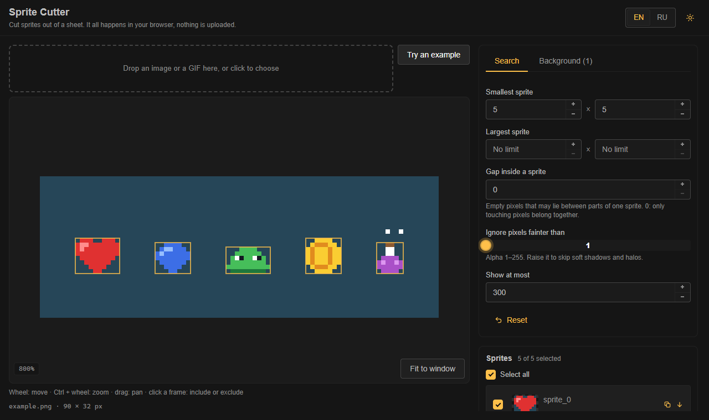
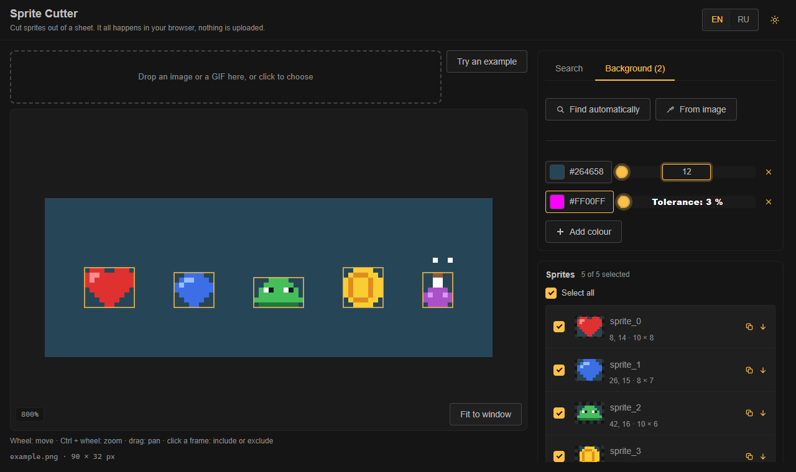

# Sprite Cutter

<p align="center">
  
  
</p>

**English** · [Русский](README.ru.md)

Cuts sprites out of a sheet in the browser: finds them by background colour, unpacks GIFs, exports JSON, CSS and a ZIP of PNGs.
Nothing is uploaded anywhere, everything runs on your machine.

**Stack:** Vue 3 + TypeScript + Vite, [TaoUI](https://www.npmjs.com/package/@1337exp/taoui) for the interface, [TaoUX](https://www.npmjs.com/package/@1337exp/taoux) for camera, wheel, i18n and storage helpers.

```bash
npm install
npm run dev         # the app
npm run build
npm test            # the detection core and the exporters
npm run typecheck
npm run screenshot  # docs/media/*.png for the README, needs Chrome or Edge
```

## What it does

- **Opens** a PNG, JPEG, WebP or GIF by drop or click (up to 32 megapixels). A GIF is unpacked frame by frame, with disposal modes, and laid out on a sheet.
- **Finds sprites** as groups of touching pixels. The background is one or several colours, each with its own tolerance; fully transparent pixels are always ignored.
  *Find automatically* reads the colour from the border of the image, *From image* picks it with a click.
- **Search settings:** the smallest and largest size, the gap inside a sprite (empty pixels that may separate parts of one sprite), the faintest alpha that still counts, the limit.
  Sprites are numbered in reading order, rows first.
- **Shows** the sheet with zoom and pan (wheel to move, Ctrl + wheel to zoom, drag to pan). A click on a frame includes or excludes the sprite.
- **Exports** a ZIP: every sprite as `sprites/<name>.png`, `spritesheet.json`, `spritesheet.css` (retina halves, positions in percent if you like) and, when the sheet is not a file (a GIF or the example), the sheet itself.
  JSON and CSS can also be copied from the panel. Names can be edited and are made safe for every file system.
- **Sliders you can type into:** right click, double click, or Enter / F2 on a focused slider opens a field right on the bar.
- English and Russian, light and dark theme.

## How it is built

```
src/
  core/   detection, GIF, PNG, ZIP, names and exporters; no DOM, so it runs in a Worker and under Node
  app/    the Vue app: workspace store, Worker for the search, components, locales
tests/    the core: detection, colours, GIF (with a real encoder), PNG, ZIP, names, output
```

The search itself is connected-component labelling with union-find in one pass, O(width × height). The *gap* is a separable dilation of the mask.
The core knows nothing about the page and is exported from [src/core/index.ts](src/core/index.ts): `detectSprites`, `guessBackground`, `decodeGif`, `toJson`, `toCss`, `buildArchive` and the rest.

The PNG encoder and the ZIP writer are our own and small (the browser's `CompressionStream` does the deflate), so no libraries are shipped for them.
The GIF decoder is a trimmed fork of [omggif](https://github.com/deanm/omggif), see [THIRD-PARTY-NOTICES.md](THIRD-PARTY-NOTICES.md).

## Not yet

Search zones (a region of the sheet to look in), detection of one sprite by a click, undo, hotkeys, pinch zoom on touch screens.

## License

[MIT](LICENSE)
