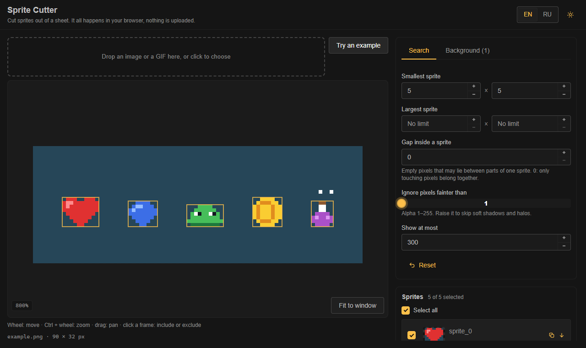
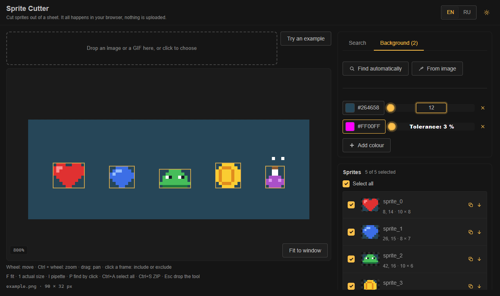

# Sprite Cutter

<p align="center">
  
  
</p>

[English](README.md) · **Русский**

Нарезает спрайты из листа прямо в браузере: ищет их по цвету фона, распаковывает GIF, экспортирует JSON, CSS и ZIP с PNG.
Ничего никуда не загружается, всё работает у вас на машине.

**Стек:** Vue 3 + TypeScript + Vite, [TaoUI](https://www.npmjs.com/package/@1337exp/taoui) для интерфейса, [TaoUX](https://www.npmjs.com/package/@1337exp/taoux) для камеры, колеса, i18n и хранилища.

```bash
npm install
npm run dev         # приложение
npm run build
npm test            # ядро поиска и экспорт
npm run typecheck
npm run screenshot  # docs/media/*.png для README, нужен Chrome или Edge
```

## Что умеет

- **Открывает** PNG, JPEG, WebP и GIF перетаскиванием или кликом (до 32 мегапикселей). GIF распаковывается по кадрам, с режимами замены, и раскладывается на лист; каждый кадр — спрайт ровно там, где он лёг (выберите *Поиск*, чтобы искать фигуры внутри кадров).
- **Находит спрайты** как группы касающихся пикселей. Фон — один или несколько цветов, у каждого свой допуск; полностью прозрачные пиксели игнорируются всегда.
  *Найти автоматически* берёт цвет с границы картинки, *С картинки* — по клику.
- **Настройки поиска:** наименьший и наибольший размер, зазор внутри спрайта (сколько пустых пикселей может разделять части одного спрайта), самая слабая альфа, которая ещё считается, предел.
  Спрайты нумеруются в порядке чтения, сначала строки.
- **Найти кликом** добавляет спрайт под выбранным пикселем, что бы ни говорили ограничения по размеру, с текущими цветами, альфой и зазором. Удобно для спрайта, который поиск пропустил; добавленные вручную можно убрать.
- **Показывает** лист с масштабом и сдвигом (колесо — сдвиг, Ctrl + колесо — масштаб, перетаскивание — сдвиг). Клик по рамке включает или исключает спрайт.
- **Экспортирует** ZIP: каждый спрайт как `sprites/<имя>.png`, `spritesheet.json`, `spritesheet.css` (ретина-половинки, позиции в процентах по желанию) и, если у листа нет файла (GIF или пример), сам лист.
  JSON и CSS можно скопировать и с панели. Имена можно править, они приводятся к безопасным для любой файловой системы.
- **Бегунки, в которые можно писать:** правый клик, двойной клик или Enter / F2 на бегунке открывают поле прямо на полосе.
- **Клавиши** (работают в любой раскладке): `F` вписать, `1` реальный размер, `I` пипетка, `P` найти кликом, `Esc` снимает инструмент, `Ctrl+A` выбрать все, `Ctrl+S` скачать ZIP.
- Русский и английский, светлая и тёмная тема.

## Как устроено

```
src/
  core/   поиск, GIF, PNG, ZIP, имена и экспорт; без DOM, поэтому работает в Worker и под Node
  app/    приложение на Vue: хранилище, Worker для поиска, компоненты, переводы
tests/    ядро: поиск, цвета, GIF (с настоящим кодировщиком), PNG, ZIP, имена, вывод
```

Сам поиск — разметка связных областей через union-find за один проход, O(ширина × высота). *Зазор* — раздельное расширение маски.
Ядро ничего не знает о странице и экспортируется из [src/core/index.ts](src/core/index.ts): `detectSprites`, `guessBackground`, `decodeGif`, `toJson`, `toCss`, `buildArchive` и остальное.

Кодировщик PNG и запись ZIP свои и маленькие (сжатие делает `CompressionStream` браузера), поэтому библиотеки для них не поставляются.
Декодер GIF — урезанный форк [omggif](https://github.com/deanm/omggif), см. [THIRD-PARTY-NOTICES.md](THIRD-PARTY-NOTICES.md).

## Пока нет

Зоны поиска (область листа, где искать), отмена действия, масштаб щипком на сенсорных экранах.

## Лицензия

[MIT](LICENSE)

## Мы

Домашняя страница: [666.io](https://666.io). Хочешь помочь, предложить идею или просто поговорить — заходи.
